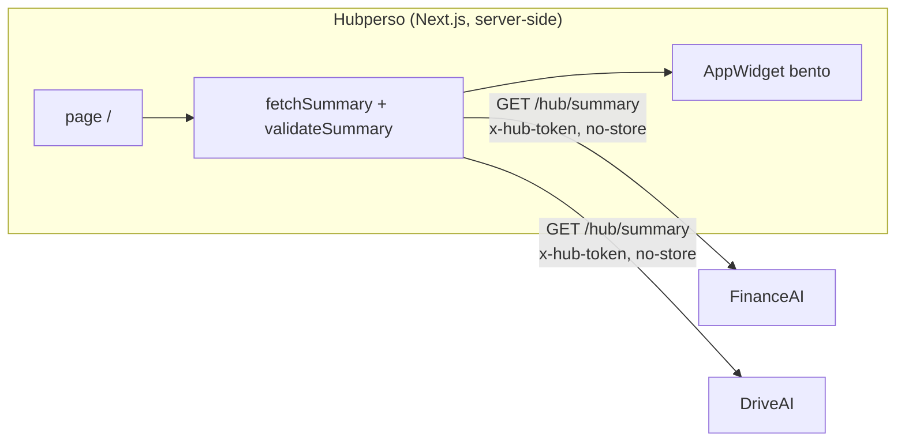

# Hubperso

Dashboard central du hub perso (`hubperso.com`). Il interroge le endpoint
`GET .../hub/summary` de chaque app (FinanceAI, DriveAI, …), valide chaque réponse
contre le contrat [`@mokarade/hub-contract`](https://github.com/MoKarade/hub-contract),
et rend un **widget générique par app** dans une grille bento. Le hub ne connaît rien
des apps au-delà du contrat.



## Architecture

- **Next.js 15 (App Router), TypeScript strict.** La page `/` est un Server
  Component `force-dynamic` : le fetch part du serveur (jamais du navigateur), donc
  **aucun CORS à configurer côté apps**, et le jeton `x-hub-token` ne quitte pas le
  serveur.
- **`lib/fetchSummary.ts`** interroge les sources en parallèle, en `no-store`, et
  **valide** chaque réponse avec `validateSummary` du contrat. Une réponse non
  conforme n'est jamais affichée comme valide.
- **États honnêtes** (jamais de fake data) : `unconfigured` (pas de jeton),
  `unauthorized` (401), `unreachable` (réseau / 5xx / timeout 9 s), `invalid` (JSON
  hors contrat), `contract-too-new` (l'app publie une version que ce build ne lit pas —
  l'app va bien, c'est le hub qui est à re-pinner). Chaque widget montre exactement ce
  qui ne va pas.
- **Résilience (dernier bon résumé)** : une app derrière plusieurs couches à démarrage
  à froid (Vercel + Apps Script) peut dépasser ponctuellement le budget réseau. Plutôt
  que clignoter en « injoignable » à chaque accroc, le hub garde en mémoire le **dernier
  résumé valide** par source et le ressert, marqué **« En cache »** avec son âge, si un
  fetch échoue alors que ce résumé a moins de 30 min. Donnée RÉELLE, jamais présentée
  comme live ; au-delà de 30 min (ou sur `unauthorized`), l'erreur honnête réapparaît.
- **`lib/url.ts`** : les `href` du contrat ne deviennent des liens que s'ils sont
  `http(s)` (le contrat accepte aussi `javascript:`/`data:` — filtrés au rendu).
- **Rafraîchissement** (`components/RefreshControls.tsx`) : la vue se rafraîchit
  automatiquement toutes les 60 s quand l'onglet est visible, plus un bouton
  « Rafraîchir » manuel — via `router.refresh()`, donc toujours server-side (session
  revérifiée, jetons jamais côté client). Limite honnête : le hub relit ce que chaque
  app **publie** ; si une app n'a pas resynchronisé ses propres sources (`dataAsOf`
  ancien), ses chiffres ne bougent pas — la synchro des sources se fait dans l'app.
- **Une horloge, pour observer sans être regardé** (`POST /api/cron/releve`, appelée par
  `.github/workflows/releve.yml`, ADR 0003). La mémoire du hub n'était alimentée que par
  l'affichage d'une page : rien ne s'enregistrait quand personne ne regardait, donc aucune
  courbe d'évolution en dehors des heures de consultation et **aucune détection de
  métrique gelée** (il faut deux relevés qui encadrent le gel). L'horloge fait ce que
  faisait l'affichage, sans l'affichage — avec un budget réseau plus large (20 s au lieu
  de 9 s) parce que personne n'attend devant et qu'un relevé perdu est un trou définitif.
- **Le seuil de « donnée en retard » vient de l'APP, jamais du hub** (`lib/gel.ts`, PUR).
  Chaque app déclare `expectedMaxAgeSec` (contrat v1.3) ; le hub ne fait que comparer. Un
  seuil écrit dans le hub serait faux pour au moins une app — 40 min est sain pour un
  véhicule qui se rafraîchit aux 30-60 min, catastrophique pour un moteur qui passe aux
  5 min — et surtout ce serait de la connaissance d'app codée en dur. Une app qui n'a pas
  déclaré son rythme n'est **pas** signalée : « je ne sais pas » ne s'affiche pas comme un
  problème.
- **Les trous de l'observation sont affichés, pas lissés** (page `/attention`, section
  « Ce que le hub a pu observer »). La cadence d'un `schedule` GitHub Actions n'est pas
  garantie — mesuré à environ trois fois plus lent que déclaré, avec un trou de 6 h 53,
  tous les runs verts. Le hub compte donc ses relevés et ses trous plutôt que de tracer
  une courbe lisse : une ligne qui relie deux points par-dessus un silence de sept heures
  n'est pas une approximation, c'est une affirmation fausse.
- **Widgets génériques** : la taille bento dérive de la richesse du summary, la
  couleur d'accent vient de `app.color`, les métriques sont formatées en fr-CA.

## Authentification

Le hub affiche des données personnelles réelles : il est **privé**. L'accès passe par
un **login Google (Auth.js / NextAuth v5)**.

- **Qui obtient une session.** Le callback `signIn` (`auth.ts`) appelle `peutSeConnecter`
  (`lib/personnes.ts`) : le **propriétaire** (`AUTHORIZED_EMAIL`, comparé en lower-case +
  trim) entre toujours, sans passer par la base ; toute autre personne doit être **active
  et avoir au moins un accès** dans la table `acces`. Un compte sans aucun accès est
  refusé : **aucune session créée**, redirection vers `/login?error=AccessDenied` avec le
  message « Accès non autorisé — ce hub est privé ».
- **Obtenir une session ≠ voir le tableau de bord.** La connexion est unique pour toutes
  les apps du hub ; les accès sont **par app** (`docs/ACCES-PAR-APP.md`). Le hub se traite
  lui-même comme une app (`APP_HUB`) : ses pages exigent en plus `aAcces(email, APP_HUB)`
  via `exigerAccesHub()` (`lib/gardeHub.ts`). Une personne connectée sans cet accès
  atterrit sur `/sans-acces`, pas sur `/login` — sinon elle se reconnecterait aussitôt
  pour retomber sur le même refus.
- **Tout est protégé.** `middleware.ts` garde l'ensemble des routes sauf `/api/auth/*`,
  `/login`, `/api/acces` et les assets statiques. Sans session : une page → redirection
  vers `/login` (avec `callbackUrl`) ; une route `/api/*` → **401 JSON** (la décision est
  isolée et testée dans `lib/authGuard.ts`).
  `/api/acces` est le seul ajout à cette liste, et il ne passe **pas** par le matcher : le
  matcher reste inchangé, c'est `isPublicPath` qui le laisse traverser. La distinction
  compte — l'endpoint n'est pas ouvert, il est authentifié **autrement** (par le `HUB_TOKEN`
  de l'app appelante, pas par une session de navigateur, puisque c'est un serveur qui
  appelle un serveur). `/api/cron/releve` suit le même mécanisme (`CRON_SECRET`), et
  `GET /api/sante` aussi, mais **sans** authentification : c'est la sonde de la vigie, elle
  ne rend que `{ ok, cause }` — jamais une donnée ni un nom de variable
  (`docs/reference-claude.md` §1). `GET /api/cout` est la seule route publique qui rend une
  donnée : le coût API des apps (le cumul avec sa date, les apps non lisibles, et le total de la
  dépense du mois en cours, jamais le détail par app), pour le relevé du suivi, qui n'a aucun jeton.
- **Défense en profondeur.** La page `/` (Server Component qui porte les jetons
  `x-hub-token` des apps) revérifie la session côté serveur avant tout fetch : sans
  session, aucune donnée n'est récupérée ni rendue.
- **Session JWT** : la session elle-même ne tient pas en base. Le hub a désormais une
  petite base Neon, mais elle ne contient **que** la liste des personnes et leurs accès
  par app — aucune donnée d'app, aucune session. Déconnexion via le bouton discret du
  header.
- **Accès par app** (`docs/ACCES-PAR-APP.md`) : le cookie de session étant partagé entre
  toutes les apps du hub, être connecté ne dit pas *où* on a le droit d'entrer. Le hub
  répond à cette question pour les autres apps via `POST /api/acces`, authentifié par le
  `HUB_TOKEN` de l'app appelante — qui l'identifie, donc une app ne peut pas interroger
  les accès d'une autre. La page `/administration` (réservée au propriétaire) permet
  d'ajouter ou de retirer quelqu'un, app par app, sans toucher à Vercel ni à la base.
  JobAI, CarAI et BatchChef appellent déjà `POST /api/acces` à chaque lecture de session.

> Le contrat, les widgets et les jetons des apps (`HUB_TOKEN_*`) sont **inchangés** :
> l'auth est une couche ajoutée par-dessus, elle ne touche pas au dashboard existant.

### Variables d'environnement (auth)

À poser dans `.env.local` (local) et dans les variables d'environnement Vercel (prod).
Aucune n'est committée.

| Variable | Rôle | Valeur attendue |
|---|---|---|
| `GOOGLE_CLIENT_ID` | Client OAuth Google (Web application) | (Google Cloud Console) |
| `GOOGLE_CLIENT_SECRET` | Secret du client OAuth | (Google Cloud Console) |
| `AUTH_SECRET` | Signature des JWT de session | `npx auth secret` |
| `AUTHORIZED_EMAIL` | Le **propriétaire** : accès à tout, toujours, sans passer par la base (`lib/personnes.ts`) | `proprietaire@exemple.com` |
| `DATABASE_URL` | Base Neon (connection string ***pooled***). **Techniquement optionnelle, pratiquement indispensable** — voir l'avertissement sous ce tableau | (Neon) |
| `AUTH_URL` | **Optionnelle** — la config utilise `trustHost`, le host de la requête suffit (local et Vercel). À poser seulement pour forcer un domaine canonique en prod, avec le protocole : `https://hubperso.com` |

⚠️ **« Optionnelle » se lisait comme « accessoire », et ça a coûté une soirée.** Le mot
était juste — l'app démarre sans — mais il cachait ce que l'absence emporte : **aucun
relevé** (donc aucune courbe, aucune détection de métrique gelée), **aucune personne autre
que le propriétaire** ne peut entrer, et l'horloge répond `503` à chaque passage. Et
comme le propriétaire est vérifié **sans réseau**, tout continue de fonctionner pour lui :
la panne n'a aucun symptôme du seul point de vue depuis lequel on la regarde. Mesuré le
14/09/2026 à 20:34 Z sur la production.

Les migrations s'appliquent au démarrage (`lib/migrations.ts`) : **aucune commande à
lancer**, ni en local ni sur Vercel.

⚠️ **La poser ne suffit pas : il faut REDÉPLOYER.** Vercel fige les variables
d'environnement au moment où un déploiement est CRÉÉ — celui qui sert déjà ne verra jamais
apparaître la nouvelle. C'est le piège de `[H-18]`, et il a encore produit une mesure fausse
le 15/09 : un relevé lancé 46 secondes avant la fin du redéploiement a rendu `503` alors que
la variable était bonne.

⚠️ **Et `HTTP 200` n'a PAS suffi à le prouver.** Le 15/09, la variable posée et redéployée, la
route répondait `200` « aucun relevé écrit — espacement minimal » avec **zéro ligne écrite** :
la table n'existait pas (`relation "releves" does not exist`), parce que la route cron
n'appelait pas `assurerMigrations()`. Corrigé (`[H-23]`) — un échec d'écriture rend désormais
`500` et teint le run en rouge. La seule preuve qui compte est un run à `"ecrits": 5`.

**Redirect URIs à configurer côté Google Cloud Console** (client OAuth) :

```
https://hubperso.com/api/auth/callback/google
https://<projet>.vercel.app/api/auth/callback/google
http://localhost:3000/api/auth/callback/google
```

### Tester le login en local

1. Copie `.env.example` en `.env.local` et renseigne les variables ci-dessus
   (+ les jetons `HUB_TOKEN_*` si tu veux des widgets réels).
2. `npm run dev` puis ouvre `http://localhost:3000`.
3. **Sans `DATABASE_URL`** — seul le propriétaire entre : accès sans session → redirection
   `/login` → **Se connecter avec Google** → `AUTHORIZED_EMAIL` → accès au hub ; tout autre
   compte → **refus** (« Accès non autorisé — ce hub est privé »).
4. **Avec `DATABASE_URL`** — c'est le seul scénario qui exerce vraiment l'invitation, et
   celui qui compte : ouvre `/administration`, ajoute une adresse, coche `hubperso`, puis
   connecte-toi avec ce compte. Attendu : il entre. Décoche l'accès `hubperso` en laissant
   la personne active : il obtient toujours une session (il a d'autres accès, ou aucun →
   refus à la porte), mais atterrit sur `/sans-acces` au lieu du tableau de bord. Les deux
   moitiés se testent séparément parce que ce sont **deux questions différentes** :
   « peut-il se connecter ? » et « a-t-il le droit d'entrer ICI ? ».

## Configuration

Copie `.env.example` en `.env.local`. Les URLs sont publiques ; les jetons sont des
secrets (variables d'environnement uniquement, jamais committés).

| Variable | Rôle |
|---|---|
| `HUB_TOKEN_FINANCEAI` | Jeton `x-hub-token` de FinanceAI |
| `HUB_TOKEN_DRIVEAI` | Jeton `x-hub-token` de DriveAI |
| `HUB_TOKEN_BATCHCHEF` | Jeton `x-hub-token` de BatchChef |
| `HUB_TOKEN_CARAI` | Jeton `x-hub-token` de CarAI |
| `HUB_TOKEN_JOBAI` | Jeton `x-hub-token` de JobAI |
| `HUB_TOKEN_MEMORYAI` | Jeton `x-hub-token` de MemoryAI (app sans invités : ne consulte jamais `/api/acces`) |
| `FINANCEAI_SUMMARY_URL` | **OBLIGATOIRE** — seule app sans URL par défaut. Son résumé vient d'un serveur MCP auto-hébergé, pas de `finance.hubperso.com` (qui sert l'app web). Absente → carte « aucune URL de résumé configurée », aucun appel réseau. |
| `DRIVEAI_SUMMARY_URL` | (option) surcharge l'URL par défaut `https://drive.hubperso.com/hub/summary` |
| `BATCHCHEF_SUMMARY_URL` | (option) surcharge l'URL par défaut `https://batchchef.hubperso.com/api/hub/summary` |
| `CARAI_SUMMARY_URL` | (option) surcharge l'URL par défaut `https://carai.hubperso.com/hub/summary` |
| `JOBAI_SUMMARY_URL` | (option) surcharge l'URL par défaut `https://emploi.hubperso.com/api/hub/summary` |
| `MEMORYAI_SUMMARY_URL` | (option) surcharge l'URL par défaut `https://memoryai.hubperso.com/hub/summary` |
| `SENTRY_DSN` | (option) active l'envoi des erreurs à Sentry, sans donnée personnelle (`lib/sentryConfig.ts`). Absente → Sentry éteint, aucun appel réseau, la CSP reste `connect-src 'self'`. Lue AU BUILD : la poser demande un redéploiement. |

Sans jeton, l'app concernée s'affiche « non configurée » — les autres continuent de
fonctionner. Ajouter une app = une entrée dans `lib/sources.ts` + sa variable de jeton.

## Développement

```bash
npm install
npm run dev        # http://localhost:3000
npm run test       # vitest (couche logique)
npm run typecheck  # tsc --noEmit
npm run build      # build de production
```

## Déploiement

Server-side. Les jetons vivent dans les variables d'environnement de l'hôte. Comme le hub
fetch en server-side, les apps n'ont aucun réglage CORS à faire.

**Cloudflare Access** (Google OAuth + MFA) peut rester devant comme couche réseau, mais
n'est **plus la barrière** : depuis que le hub a sa propre authentification applicative,
aucune donnée n'est servie sans session valide, même sans Cloudflare. Le noter parce que
l'inverse — croire que Cloudflare protège pendant que l'app est ouverte — est le sens dans
lequel l'erreur coûte quelque chose.
