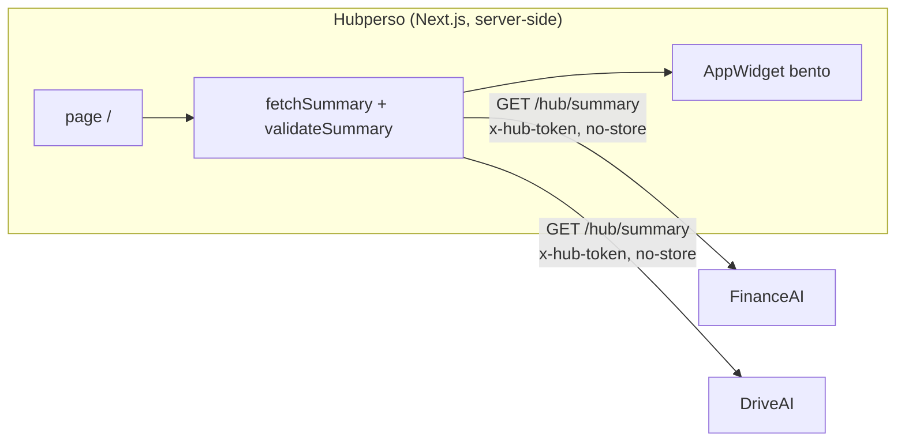

# Hubperso

Dashboard central du hub perso (`hubperso.com`). Il interroge le endpoint
`GET .../hub/summary` de chaque app (FinanceAI, DriveAI, …), valide chaque réponse
contre le contrat [`@mokarade/hub-contract`](https://github.com/MoKarade/hub-contract),
et rend un **widget générique par app** dans une grille bento. Le hub ne connaît rien
des apps au-delà du contrat.



## Architecture

- **Next.js 15 (App Router), TypeScript strict.** La page `/` est un Server
  Component `force-dynamic` : le fetch part du serveur (jamais du navigateur), donc
  **aucun CORS à configurer côté apps**, et le jeton `x-hub-token` ne quitte pas le
  serveur.
- **`lib/fetchSummary.ts`** interroge les sources en parallèle, en `no-store`, et
  **valide** chaque réponse avec `validateSummary` du contrat. Une réponse non
  conforme n'est jamais affichée comme valide.
- **États honnêtes** (jamais de fake data) : `unconfigured` (pas de jeton),
  `unauthorized` (401), `unreachable` (réseau / 5xx / timeout 5 s), `invalid` (JSON
  hors contrat). Chaque widget montre exactement ce qui ne va pas.
- **`lib/url.ts`** : les `href` du contrat ne deviennent des liens que s'ils sont
  `http(s)` (le contrat accepte aussi `javascript:`/`data:` — filtrés au rendu).
- **Widgets génériques** : la taille bento dérive de la richesse du summary, la
  couleur d'accent vient de `app.color`, les métriques sont formatées en fr-CA.

## Configuration

Copie `.env.example` en `.env.local`. Les URLs sont publiques ; les jetons sont des
secrets (variables d'environnement uniquement, jamais committés).

| Variable | Rôle |
|---|---|
| `HUB_TOKEN_FINANCEAI` | Jeton `x-hub-token` de FinanceAI |
| `HUB_TOKEN_DRIVEAI` | Jeton `x-hub-token` de DriveAI |
| `FINANCEAI_SUMMARY_URL` | (option) surcharge l'URL par défaut `https://finance.hubperso.com/hub/summary` |
| `DRIVEAI_SUMMARY_URL` | (option) surcharge l'URL par défaut `https://drive.hubperso.com/hub/summary` |

Sans jeton, l'app concernée s'affiche « non configurée » — les autres continuent de
fonctionner. Ajouter une app = une entrée dans `lib/sources.ts` + sa variable de jeton.

## Développement

```bash
npm install
npm run dev        # http://localhost:3000
npm run test       # vitest (couche logique)
npm run typecheck  # tsc --noEmit
npm run build      # build de production
```

## Déploiement

Server-side, derrière **Cloudflare Access** (Google OAuth + MFA) pour toute exposition
Internet. Les jetons vivent dans les variables d'environnement de l'hôte. Comme le hub
fetch en server-side, les apps n'ont aucun réglage CORS à faire.
