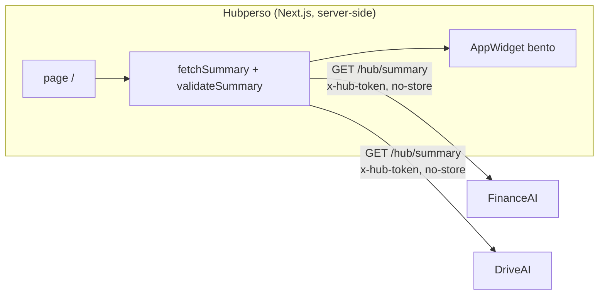

# Hubperso

Dashboard central du hub perso (`hubperso.com`). Il interroge le endpoint
`GET .../hub/summary` de chaque app (FinanceAI, DriveAI, …), valide chaque réponse
contre le contrat [`@mokarade/hub-contract`](https://github.com/MoKarade/hub-contract),
et rend un **widget générique par app** dans une grille bento. Le hub ne connaît rien
des apps au-delà du contrat.



## Architecture

- **Next.js 15 (App Router), TypeScript strict.** La page `/` est un Server
  Component `force-dynamic` : le fetch part du serveur (jamais du navigateur), donc
  **aucun CORS à configurer côté apps**, et le jeton `x-hub-token` ne quitte pas le
  serveur.
- **`lib/fetchSummary.ts`** interroge les sources en parallèle, en `no-store`, et
  **valide** chaque réponse avec `validateSummary` du contrat. Une réponse non
  conforme n'est jamais affichée comme valide.
- **États honnêtes** (jamais de fake data) : `unconfigured` (pas de jeton),
  `unauthorized` (401), `unreachable` (réseau / 5xx / timeout 9 s), `invalid` (JSON
  hors contrat). Chaque widget montre exactement ce qui ne va pas.
- **Résilience (dernier bon résumé)** : une app derrière plusieurs couches à démarrage
  à froid (Vercel + Apps Script) peut dépasser ponctuellement le budget réseau. Plutôt
  que clignoter en « injoignable » à chaque accroc, le hub garde en mémoire le **dernier
  résumé valide** par source et le ressert, marqué **« En cache »** avec son âge, si un
  fetch échoue alors que ce résumé a moins de 30 min. Donnée RÉELLE, jamais présentée
  comme live ; au-delà de 30 min (ou sur `unauthorized`), l'erreur honnête réapparaît.
- **`lib/url.ts`** : les `href` du contrat ne deviennent des liens que s'ils sont
  `http(s)` (le contrat accepte aussi `javascript:`/`data:` — filtrés au rendu).
- **Rafraîchissement** (`components/RefreshControls.tsx`) : la vue se rafraîchit
  automatiquement toutes les 60 s quand l'onglet est visible, plus un bouton
  « Rafraîchir » manuel — via `router.refresh()`, donc toujours server-side (session
  revérifiée, jetons jamais côté client). Limite honnête : le hub relit ce que chaque
  app **publie** ; si une app n'a pas resynchronisé ses propres sources (`dataAsOf`
  ancien), ses chiffres ne bougent pas — la synchro des sources se fait dans l'app.
- **Widgets génériques** : la taille bento dérive de la richesse du summary, la
  couleur d'accent vient de `app.color`, les métriques sont formatées en fr-CA.

## Authentification

Le hub affiche des données personnelles réelles : il est **privé**. L'accès passe par
un **login Google (Auth.js / NextAuth v5)**.

- **Qui obtient une session.** Le callback `signIn` (`auth.ts`) appelle `peutSeConnecter`
  (`lib/personnes.ts`) : le **propriétaire** (`AUTHORIZED_EMAIL`, comparé en lower-case +
  trim) entre toujours, sans passer par la base ; toute autre personne doit être **active
  et avoir au moins un accès** dans la table `acces`. Un compte sans aucun accès est
  refusé : **aucune session créée**, redirection vers `/login?error=AccessDenied` avec le
  message « Accès non autorisé — ce hub est privé ».
- **Obtenir une session ≠ voir le tableau de bord.** La connexion est unique pour toutes
  les apps du hub ; les accès sont **par app** (`docs/ACCES-PAR-APP.md`). Le hub se traite
  lui-même comme une app (`APP_HUB`) : ses pages exigent en plus `aAcces(email, APP_HUB)`
  via `exigerAccesHub()` (`lib/gardeHub.ts`). Une personne connectée sans cet accès
  atterrit sur `/sans-acces`, pas sur `/login` — sinon elle se reconnecterait aussitôt
  pour retomber sur le même refus.
- **Tout est protégé.** `middleware.ts` garde l'ensemble des routes sauf `/api/auth/*`,
  `/login` et les assets statiques. Sans session : une page → redirection vers `/login`
  (avec `callbackUrl`) ; une route `/api/*` → **401 JSON** (la décision est isolée et
  testée dans `lib/authGuard.ts`).
- **Défense en profondeur.** La page `/` (Server Component qui porte les jetons
  `x-hub-token` des apps) revérifie la session côté serveur avant tout fetch : sans
  session, aucune donnée n'est récupérée ni rendue.
- **Session JWT** : la session elle-même ne tient pas en base. Le hub a désormais une
  petite base Neon, mais elle ne contient **que** la liste des personnes et leurs accès
  par app — aucune donnée d'app, aucune session. Déconnexion via le bouton discret du
  header.
- **Accès par app** (`docs/ACCES-PAR-APP.md`) : le cookie de session étant partagé entre
  toutes les apps du hub, être connecté ne dit pas *où* on a le droit d'entrer. Le hub
  répond à cette question pour les autres apps via `POST /api/acces`, authentifié par le
  `HUB_TOKEN` de l'app appelante — qui l'identifie, donc une app ne peut pas interroger
  les accès d'une autre. Reste à faire : la page d'administration et le module client
  dans JobAI, CarAI et BatchChef (l'endpoint est prêt, rien ne l'appelle encore).

> Le contrat, les widgets et les jetons des apps (`HUB_TOKEN_*`) sont **inchangés** :
> l'auth est une couche ajoutée par-dessus, elle ne touche pas au dashboard existant.

### Variables d'environnement (auth)

À poser dans `.env.local` (local) et dans les variables d'environnement Vercel (prod).
Aucune n'est committée.

| Variable | Rôle | Valeur attendue |
|---|---|---|
| `GOOGLE_CLIENT_ID` | Client OAuth Google (Web application) | (Google Cloud Console) |
| `GOOGLE_CLIENT_SECRET` | Secret du client OAuth | (Google Cloud Console) |
| `AUTH_SECRET` | Signature des JWT de session | `npx auth secret` |
| `AUTHORIZED_EMAIL` | Le **propriétaire** : accès à tout, toujours, sans passer par la base (`lib/personnes.ts`) | `marc.richard4@gmail.com` |
| `DATABASE_URL` | **Optionnelle** — base Neon (connection string *pooled*) pour la liste des personnes et leurs accès. Absente : seul le propriétaire entre, et l'app le dit |
| `AUTH_URL` | **Optionnelle** — la config utilise `trustHost`, le host de la requête suffit (local et Vercel). À poser seulement pour forcer un domaine canonique en prod, avec le protocole : `https://hubperso.com` |

**Redirect URIs à configurer côté Google Cloud Console** (client OAuth) :

```
https://hubperso.com/api/auth/callback/google
https://<projet>.vercel.app/api/auth/callback/google
http://localhost:3000/api/auth/callback/google
```

### Tester le login en local

1. Copie `.env.example` en `.env.local` et renseigne les 5 variables ci-dessus
   (+ les jetons `HUB_TOKEN_*` si tu veux des widgets réels).
2. `npm run dev` puis ouvre `http://localhost:3000`.
3. Flux attendu : accès sans session → redirection `/login` → **Se connecter avec
   Google** → si tu te connectes avec `marc.richard4@gmail.com` → accès au hub ;
   avec tout autre compte Google → **refus** (« Accès non autorisé — ce hub est privé »).

## Configuration

Copie `.env.example` en `.env.local`. Les URLs sont publiques ; les jetons sont des
secrets (variables d'environnement uniquement, jamais committés).

| Variable | Rôle |
|---|---|
| `HUB_TOKEN_FINANCEAI` | Jeton `x-hub-token` de FinanceAI |
| `HUB_TOKEN_DRIVEAI` | Jeton `x-hub-token` de DriveAI |
| `HUB_TOKEN_BATCHCHEF` | Jeton `x-hub-token` de BatchChef |
| `FINANCEAI_SUMMARY_URL` | (option) surcharge l'URL par défaut `https://finance.hubperso.com/hub/summary` |
| `DRIVEAI_SUMMARY_URL` | (option) surcharge l'URL par défaut `https://drive.hubperso.com/hub/summary` |
| `BATCHCHEF_SUMMARY_URL` | (option) surcharge l'URL par défaut `https://batchchef.hubperso.com/hub/summary` |

Sans jeton, l'app concernée s'affiche « non configurée » — les autres continuent de
fonctionner. Ajouter une app = une entrée dans `lib/sources.ts` + sa variable de jeton.

## Développement

```bash
npm install
npm run dev        # http://localhost:3000
npm run test       # vitest (couche logique)
npm run typecheck  # tsc --noEmit
npm run build      # build de production
```

## Déploiement

Server-side, derrière **Cloudflare Access** (Google OAuth + MFA) pour toute exposition
Internet. Les jetons vivent dans les variables d'environnement de l'hôte. Comme le hub
fetch en server-side, les apps n'ont aucun réglage CORS à faire.
