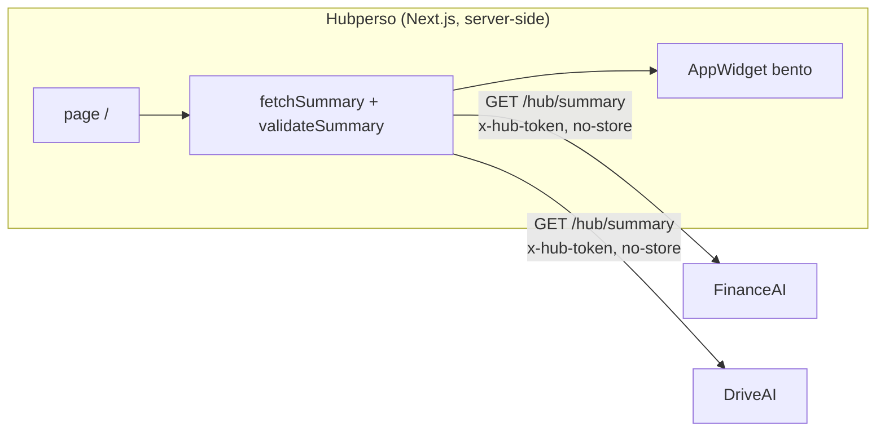

# Hubperso

Dashboard central du hub perso (`hubperso.com`). Il interroge le endpoint
`GET .../hub/summary` de chaque app (FinanceAI, DriveAI, …), valide chaque réponse
contre le contrat [`@mokarade/hub-contract`](https://github.com/MoKarade/hub-contract),
et rend un **widget générique par app** dans une grille bento. Le hub ne connaît rien
des apps au-delà du contrat.



## Architecture

- **Next.js 15 (App Router), TypeScript strict.** La page `/` est un Server
  Component `force-dynamic` : le fetch part du serveur (jamais du navigateur), donc
  **aucun CORS à configurer côté apps**, et le jeton `x-hub-token` ne quitte pas le
  serveur.
- **`lib/fetchSummary.ts`** interroge les sources en parallèle, en `no-store`, et
  **valide** chaque réponse avec `validateSummary` du contrat. Une réponse non
  conforme n'est jamais affichée comme valide.
- **États honnêtes** (jamais de fake data) : `unconfigured` (pas de jeton),
  `unauthorized` (401), `unreachable` (réseau / 5xx / timeout 5 s), `invalid` (JSON
  hors contrat). Chaque widget montre exactement ce qui ne va pas.
- **`lib/url.ts`** : les `href` du contrat ne deviennent des liens que s'ils sont
  `http(s)` (le contrat accepte aussi `javascript:`/`data:` — filtrés au rendu).
- **Widgets génériques** : la taille bento dérive de la richesse du summary, la
  couleur d'accent vient de `app.color`, les métriques sont formatées en fr-CA.

## Authentification

Le hub affiche des données personnelles réelles : il est **privé**. L'accès passe par
un **login Google (Auth.js / NextAuth v5)** restreint à **une seule adresse**.

- **Un seul compte admis.** Le callback `signIn` (`auth.ts`) n'autorise que l'adresse
  `AUTHORIZED_EMAIL` (comparée en lower-case + trim, logique pure dans `lib/authorized.ts`).
  Tout autre compte Google est refusé : **aucune session créée**, redirection vers
  `/login?error=AccessDenied` avec le message « Accès non autorisé — ce hub est privé ».
- **Tout est protégé.** `middleware.ts` garde l'ensemble des routes sauf `/api/auth/*`,
  `/login` et les assets statiques. Sans session : une page → redirection vers `/login`
  (avec `callbackUrl`) ; une route `/api/*` → **401 JSON** (la décision est isolée et
  testée dans `lib/authGuard.ts`).
- **Défense en profondeur.** La page `/` (Server Component qui porte les jetons
  `x-hub-token` des apps) revérifie la session côté serveur avant tout fetch : sans
  session, aucune donnée n'est récupérée ni rendue.
- **Session JWT**, sans base de données (le hub n'en a pas). Déconnexion via le bouton
  discret du header.

> Le contrat, les widgets et les jetons des apps (`HUB_TOKEN_*`) sont **inchangés** :
> l'auth est une couche ajoutée par-dessus, elle ne touche pas au dashboard existant.

### Variables d'environnement (auth)

À poser dans `.env.local` (local) et dans les variables d'environnement Vercel (prod).
Aucune n'est committée.

| Variable | Rôle | Valeur attendue |
|---|---|---|
| `GOOGLE_CLIENT_ID` | Client OAuth Google (Web application) | (Google Cloud Console) |
| `GOOGLE_CLIENT_SECRET` | Secret du client OAuth | (Google Cloud Console) |
| `AUTH_SECRET` | Signature des JWT de session | `npx auth secret` |
| `AUTHORIZED_EMAIL` | Unique adresse admise | `marc.richard4@gmail.com` |
| `AUTH_URL` | **Optionnelle** — la config utilise `trustHost`, le host de la requête suffit (local et Vercel). À poser seulement pour forcer un domaine canonique en prod, avec le protocole : `https://hubperso.com` |

**Redirect URIs à configurer côté Google Cloud Console** (client OAuth) :

```
https://hubperso.com/api/auth/callback/google
https://<projet>.vercel.app/api/auth/callback/google
http://localhost:3000/api/auth/callback/google
```

### Tester le login en local

1. Copie `.env.example` en `.env.local` et renseigne les 5 variables ci-dessus
   (+ les jetons `HUB_TOKEN_*` si tu veux des widgets réels).
2. `npm run dev` puis ouvre `http://localhost:3000`.
3. Flux attendu : accès sans session → redirection `/login` → **Se connecter avec
   Google** → si tu te connectes avec `marc.richard4@gmail.com` → accès au hub ;
   avec tout autre compte Google → **refus** (« Accès non autorisé — ce hub est privé »).

## Configuration

Copie `.env.example` en `.env.local`. Les URLs sont publiques ; les jetons sont des
secrets (variables d'environnement uniquement, jamais committés).

| Variable | Rôle |
|---|---|
| `HUB_TOKEN_FINANCEAI` | Jeton `x-hub-token` de FinanceAI |
| `HUB_TOKEN_DRIVEAI` | Jeton `x-hub-token` de DriveAI |
| `FINANCEAI_SUMMARY_URL` | (option) surcharge l'URL par défaut `https://finance.hubperso.com/hub/summary` |
| `DRIVEAI_SUMMARY_URL` | (option) surcharge l'URL par défaut `https://drive.hubperso.com/hub/summary` |

Sans jeton, l'app concernée s'affiche « non configurée » — les autres continuent de
fonctionner. Ajouter une app = une entrée dans `lib/sources.ts` + sa variable de jeton.

## Développement

```bash
npm install
npm run dev        # http://localhost:3000
npm run test       # vitest (couche logique)
npm run typecheck  # tsc --noEmit
npm run build      # build de production
```

## Déploiement

Server-side, derrière **Cloudflare Access** (Google OAuth + MFA) pour toute exposition
Internet. Les jetons vivent dans les variables d'environnement de l'hôte. Comme le hub
fetch en server-side, les apps n'ont aucun réglage CORS à faire.
